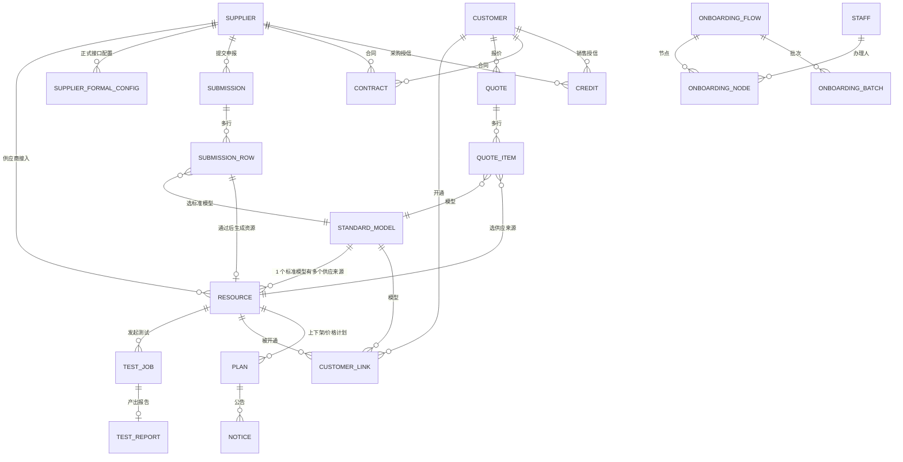

# 目标数据模型（2026-10-20）

> 依据：**仅** PM 原型 `Token-Operations-Demo-v0.19.html`（已真实渲染逐屏走查）
> + `开放接口对接说明（open-api v1）` + 你确认的口径。
> **未参考** `docs` 下的旧详细设计/需求规格文档。
>
> 标注约定：
> - ✅ **原型直证**：原型数据/界面里能直接看到。
> - 🔶 **接口直证**：测试平台接口文档里能直接看到。
> - ⚠️ **推断**：我从原型推出来、需要 PM 确认的。

---

## 一、设计原则（都来自已确认口径）

1. **三层主线**：标准模型（catalog）→ 供应来源（resource）→ 客户开通（link）。
2. **读取全员可见，操作按绑定人**：不用角色权限，用 `sales_id / buyer_id / assignee_id` 这类归属字段控操作。
3. **无审批**：没有 approval 表/审批状态；申报直接进办理。
4. **客户不登录**：没有客户账号/客户门户；客户只是被管理对象。
5. **定价用系数**：`成本 = 官方价 × 采购系数 c`；`毛利 g = 1 − c/s`；`s = c/(1−g)`。
   毛利 <3% 要二次确认并留痕。
6. **测试由供应商触发**：resource 上挂测试凭据与测试结果；无测试/连通失败不能提交报价。
7. **正式接口配置与测试凭据分开存**。
8. **授信=额度**，带方向与版本，不是流程。
9. **历史可追溯**：报价快照、申报版本、官方资料版本、操作留痕。

---

## 二、实体关系总览



文字版：

```
standard_model ──< resource >── supplier
                     │
                     ├──< test_job ── test_report
                     └──< customer_link >── customer
                                              │
                                              └──< quote ──< quote_item >── resource
supplier/customer ──< contract / credit
onboarding_flow ──< onboarding_node (assignee=staff)
resource ──< plan ──< notice
```

---

## 三、表设计

### A. 主数据

#### `standard_model`（标准模型库）✅
| 字段 | 类型 | 说明 |
|---|---|---|
| id | bigserial PK | |
| company | text | 厂商（DeepSeek/阿里云/OpenAI/Google…） |
| model_type | enum | TEXT/IMAGE/VIDEO/AUDIO |
| name | text | **官方标准名**（如 `DeepSeek-V3`） |
| official_id | text | 官方 ID（如 `deepseek-chat`） |
| input_modalities / output_modalities | text[] | 输入/输出模态 |
| capacity | jsonb | 上下文、最大输入/输出等 |
| abilities | jsonb | thinking / function_calling / structured_outputs / streaming / cache |
| price_items | jsonb | `[{label, rate, unit, currency, conditions}]` |
| api_access | jsonb | 端点、限流、访问条件 |
| lifecycle | jsonb | 发布、版本、生命周期 |
| sources | jsonb | `[{label,url}]` 官方来源 |
| checked_at | date | 资料核验日期 |
| status | enum | DRAFT/ACTIVE/DEPRECATED |
| updated_by / updated_at | | |

#### `standard_model_version`（官方资料版本）✅
- id, standard_model_id, version_no, snapshot jsonb, source, checked_at, created_by, created_at
- 用途：保留历史官方资料（原型"保留历史实体/更新结果"）。

#### `crawl_job`（官方资料拉取任务）✅（原型有"上次成功/最近尝试/自动抓取失败"）
- id, standard_model_id, source_url, status(PENDING/RUNNING/SUCCESS/FAILED), attempt_at, success_at, error, raw_hash, created_at

#### `crawl_diff`（拉取差异暂存）⚠️（自动拉取方案要求）
- id, standard_model_id, field, old_value jsonb, new_value jsonb, source_url, quote text, confidence numeric, status(PENDING/ACCEPTED/REJECTED), reviewed_by, reviewed_at
- 用途：**价格等字段不得静默覆盖**，人工确认后才写回 `standard_model`。

#### `supplier`（供应商）✅
| 字段 | 说明 |
|---|---|
| id | |
| name | 企业名称 |
| region | CN/OVERSEAS（国内/海外主体，⚠️ 有上架历史后锁定） |
| registration_no | 当地注册编号 |
| contact / phone | 对接负责人/手机号 |
| established | 是否已建立合作（原型的 established） |
| tax_rate | 税率（**不参与报价/毛利**，仅资料） |
| settlement_currency | 结算币种 |
| credit_amount / credit_direction | 授信（供应商→我方） |
| website / account / password_enc | 供应商网站账户 |
| status | ACTIVE/FROZEN 等 |
| created_at / updated_at | |

#### `supplier_formal_config`（正式接口配置）✅
- id, supplier_id, scope(适用模型/范围说明), base_url, api_key_enc, note, updated_by, updated_at
- **与测试凭据分开存**（v0.19 明确）。

#### `supplier_qualification`（供应商资质/证明）✅
- id, supplier_id, name, file, uploaded_at

---

### B. 供应来源与测试

#### `resource`（供应来源，核心表）✅
| 字段 | 说明 |
|---|---|
| id | |
| standard_model_id | FK → standard_model |
| supplier_id | FK → supplier |
| **supplier_model_name** | **供方模型名称**（供应商自己的叫法，可与官方名不同） |
| **standard_model_name_snapshot** | 官方名快照（展示用，防官方改名） |
| region | CN/OVERSEAS（部署节点） |
| **test_base_url / test_api_key_enc** | **测试凭据**（与正式配置分开） |
| **coefficient** | 采购系数 numeric(8,4)，约束 **(0,1]** |
| state | PENDING_TEST / PENDING_ADMIT / ADMITTED / OFFLINE（+ 计划态） |
| ever_admitted | 是否曾接入（原型 everAdmitted） |
| buyer_id | **归属采购人**（绑定式操作） |
| latest_test_report_id | 最新测试报告 |
| created_at / updated_at | |

约束：
- `UNIQUE(supplier_id, standard_model_id, region)`（防重复接入；原型"已有该标准模型资源，请用独立变更申报"）。
- `CHECK (coefficient > 0 AND coefficient <= 1)`。

#### `test_job`（测试任务）🔶
- id, resource_id, category(health/baseline/functional/evaluation/intelligence/stress/imagespec)
- external_job_id（平台 job_id）, idempotency_key, status, verdict
- request_payload jsonb（target/params）, response_summary jsonb
- created_by（供应商账号/内部）, created_at, finished_at

#### `test_report`（测试报告/指标）🔶✅
- id, test_job_id, resource_id
- connection_ms, connection_passed, stress_passed
- rps, tps, availability, error_rate, ttft_ms, tpot_ms, sample_count
- report_url, report_format, report_file, scene, tested_by, tested_at
- 用途：回填原型"连通耗时 / RPS / TPS / 测试报告"。

#### `webhook_event`（回调去重）🔶
- event_id PK, job_id, payload jsonb, received_at, processed_at
- 用途：`event_id=evt_<job_id>_<status>` 幂等。

---

### C. 申报与办理（无审批）

#### `submission`（申报）✅
- id, supplier_id, kind(SUPPLIER_NEW/MODEL_NEW/PRICE_CHANGE), region
- status（办理中/已完成/已撤回…**无审批态**）
- reason, submitted_by, submitted_at, completed_at

#### `submission_row`（申报行）✅
- id, submission_id, standard_model_id, **supplier_model_name**
- test_base_url, test_api_key_enc, **coefficient**
- **participate_test** bool（原型"参与测试"勾选）
- test_report_id, row_status
- resource_id（通过后关联生成的 resource）

#### `submission_version`（申报版本）✅
- id, submission_id, version_no, snapshot jsonb, created_by, created_at
- 用途：v0.19"保留原申报版本"。

#### `onboarding_flow`（办理流程）✅
- id, kind(SUPPLIER/CUSTOMER), owner_id, status, current_node, created_at

#### `onboarding_node`（流程节点）✅
- id, flow_id, node_key(PREP/CONFIG/TEST/CONTRACT/CREDIT/ACCOUNT/EXECUTE)
- enabled, status(DISABLED/IN_PROGRESS/DONE/WAITING_PREDECESSOR)
- **assignee_id**（办理人，绑定式）
- completed_at, note

#### `onboarding_batch`（办理批次）✅
- id, flow_id, supplier_id, models jsonb, config_done bool, status, completed_at

---

### D. 客户与开通

#### `customer`（客户）✅
- id, name, region(CN/OVERSEAS), platform(国内B端/海外B端)
- service_status（服务中/接入中）
- **sales_id**（销售归属，绑定式）
- settlement_currency, tax_rate
- credit_amount / credit_direction（我方→客户）
- contract_status（办理中/已归档）
- created_at / updated_at

#### `customer_link`（客户开通关系）✅
- id, customer_id, resource_id, standard_model_id
- state(ACTIVE/PENDING_DISABLE/DISABLE_PENDING/SUPPLY_OFFLINE_STOP)（已开通/待禁用/禁用待执行/供应下架停止）
- **sale_coefficient**（销售系数）
- **quote_snapshot** jsonb（报价快照，历史不重写）
- requirements jsonb（客户要求，如 rps/accuracy）
- activated_at, archived bool
- 约束：`UNIQUE(customer_id, resource_id) WHERE NOT archived`。

---

### E. 报价与合同

#### `quote`（报价单）✅
- id, **customer_id NOT NULL**（FK → customer，报价单必须归属客户）, customer_name, seller_company
- region, currency, quote_no, quote_date, contact, note, operator_id
- status, created_at / updated_at

#### `quote_item`（报价行）✅
- id, quote_id, standard_model_id, resource_id
- **coefficient_snapshot**（采购系数快照）
- **margin**（毛利率）, **sale_coefficient**, **discount**（折扣）
- price_items_snapshot jsonb
- **margin_confirm** jsonb（<3% 二次确认：confirmed_by/at/reason）

#### `quote_version`（报价版本/快照）✅
- id, quote_id, version_no, snapshot jsonb, created_by, created_at
- 用途：历史报价记录、历次版本。

#### `contract`（合同）✅
- id, subject_type(SUPPLIER/CUSTOMER), subject_id
- status(PROCESSING/ARCHIVED), signed_at, version, file, note

#### `credit`（授信额度）✅
- id, subject_type(SUPPLIER/CUSTOMER), subject_id
- direction(SUPPLIER_TO_US / US_TO_CUSTOMER)
- amount, currency, version, effective_at, note
- 用途：额度 + 版本记录，不是流程。

---

### F. 变更与公告

#### `plan`（上下架/价格计划）✅
- id, resource_id, kind(ONLINE/OFFLINE/PRICE_CHANGE)
- reason, due_at, before jsonb, after jsonb, status(PENDING/DONE/CANCELED), created_by, created_at

#### `notice`（公告）✅
- id, type(ONLINE_OFFLINE_PLAN/RESOURCE_CHANGE/COST_CHANGE), target_type, target_id, payload jsonb, created_at

#### `notice_read`（阅读记录）✅
- notice_id, staff_id, read_at

---

### G. 人员与留痕（重点：操作记录是一等公民）

> 原型的几乎每个视图都有「操作记录」子页（工作台/标准模型库/模型详情/供应商详情/报价单/客户详情/账户设置…），
> 所以**留痕不是附属功能，是数据模型的一部分**。

#### `staff`（内部人员）✅
- id, name, **function_label**（运营/研发/商务，仅展示/分工），login_id, phone, status
- 说明：function_label **不是权限角色**；操作靠 assignment 字段。

#### `operation_log`（统一操作留痕，append-only）✅
| 字段 | 说明 |
|---|---|
| id | bigserial |
| entity_type | standard_model / resource / supplier / customer / quote / submission / contract / credit / plan / notice / staff |
| entity_id | 业务主键 |
| action | CREATE / UPDATE / STATE_CHANGE / CONFIRM / ASSIGN / CONFIG_CHANGE / TEST_TRIGGER / MARGIN_OVERRIDE / WITHDRAW … |
| operator_id | 操作人（staff.id，系统操作可空） |
| operator_name_snapshot | 操作人姓名快照（防改名丢失） |
| before / after | jsonb，变更前后（字段级 diff 或整行快照） |
| reason | 变更说明/理由（二次确认、驳回、撤回等必填） |
| request_id / trace_id | 请求链路（与幂等键、审计对齐） |
| created_at | timestamptz |

**硬规则**：
1. **每个写接口必须在同一事务里写 `operation_log`**，业务写成功但日志失败 → 整个事务回滚。
2. **append-only**：不允许 update/delete；纠错用新增一条"更正记录"。
3. 列表/详情接口的「操作记录」页 = 按 `(entity_type, entity_id)` 倒序查。
4. 必须有索引：`(entity_type, entity_id, created_at DESC)`。

用途：所有"操作记录"子视图统一走这一张表，不再每个模块各写一份历史。

#### `assignment_log`（绑定变更留痕）⚠️
- 可并入 `operation_log`（action=ASSIGN），也可独立表便于按人查：
  `entity_type(CUSTOMER/RESOURCE/FLOW_NODE), entity_id, field(sales_id/buyer_id/assignee_id), old_staff_id, new_staff_id, changed_by, changed_at`

#### `margin_override`（<3% 二次确认留痕）✅
- id, quote_item_id, margin, sale_coefficient, confirmed_by, confirmed_at, reason
- 也可作为 `operation_log` 的 `MARGIN_OVERRIDE` 一条，但独立表便于报表统计。

---

### H. 休眠的权限基础设施（保留但不用）

- `role` / `permission_point` / `role_permission` / `staff_role`（现有表保留，开关关闭）。
- 这一版不校验角色；`RequirePerm` 钩子保留，未来开启。

---

## 四、关键状态机

- **resource**：`待测试 → 待接入 → 已接入 → 已下架`；另有 `下架计划 / 上架计划`。
- **customer_link**：`已开通 / 待禁用 / 禁用待执行 / 供应下架停止`。
- **合同**：`办理中 → 已归档`。
- **申报**：`办理中 → 已完成 / 已撤回`（**无审批**）。
- **流程节点**：`未启用 / 进行中 / 已完成 / 等待前置节点`。
- **测试任务**：`queued → running → succeeded/failed/aborted/canceled`；`verdict=pass/fail/abort/…`。

---

## 五、与原型字段对照

| 原型字段 | 目标表.字段 |
|---|---|
| catalog.company/type/name/official | standard_model.company/model_type/name/official_id |
| catalog 8 列参数 | standard_model.capacity/abilities/price_items/api_access/lifecycle/sources |
| suppliers.ready{国内/海外} | supplier.region + 就绪标记 |
| resources.model | resource.standard_model_id |
| （供方模型名） | resource.supplier_model_name |
| resources.url/key | resource.test_base_url/test_api_key_enc |
| resources.coefficient | resource.coefficient |
| resources.report{connection,stress,rps,tps} | test_report.connection_*/stress_passed/rps/tps |
| resources.state | resource.state |
| links.state/quote/requirements | customer_link.state/quote_snapshot/requirements |
| customers.sales/credit/contract | customer.sales_id/credit_amount/contract_status |
| flows.nodes{prep…} | onboarding_node.node_key |
| batches.results | test_report / onboarding_batch |
| submissions.rows/versions | submission_row / submission_version |
| drafts.items{margin,discount,saleCoefficient} | quote_item.margin/discount/sale_coefficient |

---

## 六、与测试平台字段对照

| 平台 | 目标表 |
|---|---|
| `test-jobs.job_id` | test_job.external_job_id |
| `target.model` | resource.standard_model_id（官方 ID） |
| `target.base_url` / `api_key` | resource.test_base_url / test_api_key_enc |
| `owner` | supplier.name/id |
| `verdict` / `summary` | test_report（verdict + 指标） |
| `report_url` | test_report.report_url |
| 回调 `event_id` | webhook_event.event_id |
| 复测 `review_of` | test_job.review_of（⚠️ 本版先不做） |

---

## 七、与 M1–M12 的映射

| 模块 | 目标表 |
|---|---|
| M1 模型 | standard_model + standard_model_version + resource |
| M2 官方价同步 | crawl_job + crawl_diff（+ standard_model 价格字段） |
| M3 供应商 | supplier + supplier_formal_config + supplier_qualification |
| M4 报价 | submission + submission_row + onboarding_flow/node/batch + test_job/report |
| M5 成本 | 只保留 coefficient/margin 计算（无独立表） |
| M6 定价策略 | 无（下线） |
| M7 价目表 | 无（下线） |
| M8 客户 | customer + customer_link |
| M9 客户报价 | quote + quote_item + quote_version |
| M10 财务结算 | contract + credit（账务/汇率锁无） |
| M11 组织与权限 | staff + assignment_log；role/permission 休眠 |
| M12 审计 | operation_log（统一操作留痕） |

---

## 八、确认状态（2026-10-20 已拍板）

### 已确认
1. **一个资源只服务一地**（region 单值，要两地拆两行）。✅
2. **提交申报按"至少一条通过"**（整批里至少一条连通+压力通过即可，不是逐条都要）。✅
3. **测试报告保留多条**（`test_report` 多行历史，resource 指向最新）。✅
4. **授信独立模块**（contract / credit 独立表）。✅
5. **报价单客户不可为空**（`quote.customer_id NOT NULL`）。✅
6. **操作记录是一等公民**：每个写接口同事务写 `operation_log`，每个实体都能按 `(entity_type, entity_id)` 查操作记录。✅

### 仍为我的推断（如与 PM 不一致请指出）
1. ⚠️ 申报无审批：状态用"办理中/已完成/已撤回"，原型残留的"待审批/通过"是旧壳。
2. ⚠️ 官方资料自动拉取的 LLM 参与：`crawl_diff` 暂存确认，价格不静默覆盖。
3. ⚠️ function_label（运营/研发/商务）只做展示与分工，不做权限；操作靠 `sales_id/buyer_id/assignee_id`。
4. ⚠️ 税率不参与报价/毛利（原型弹窗明确写），只作资料字段。
5. ⚠️ 客户无账号：没有 customer_account 表，客户只是数据主体。
6. ⚠️ 报价单行存 coefficient/margin/sale_coefficient 快照，历史不重写。

---

## 九、下一步

1. 按第八节"已确认"落 **PostgreSQL DDL + migration**（先建新表，不动旧表）。
2. **留痕先落**：`operation_log` 与索引、写接口同事务规则。
3. 再做自动拉取（crawl_job/diff）与测试平台对接（test_job/report/webhook_event）的接口骨架。
